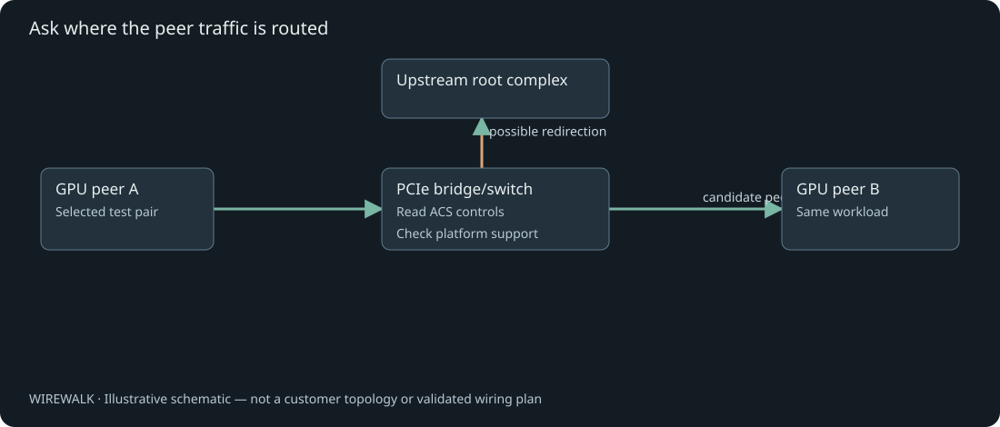

## The symptom

In this constructed scenario, a two-node training job communicates poorly even though the InfiniBand links are active and a host-buffer network test looks healthy. An intra-node peer test is also weaker for some GPU pairs. Buying a faster switch would be premature: the pair dependence points to a path inside a server.

The investigation starts with an explicit boundary. The nodes are dedicated qualification systems, no other users depend on them, and the platform team controls firmware and isolation settings. A virtualized or mixed-trust system needs a different review because peer routing and device isolation are related.

## Keep three hypotheses separate

1. The GPUs are separated by a PCIe topology with a different achievable peer path.
2. Access Control Services are redirecting traffic upstream on part of that path.
3. The application or communication stack is staging data because its direct path is unavailable for another reason.

A topology matrix, one ACS bit or one NCCL message cannot settle all three. Collect the PCIe tree, negotiated link capabilities, active driver/runtime, GPU pair identity and the selected communication path. Compare the same pair and message sizes across repeats.

```bash
nvidia-smi topo -m
lspci -D -t
lspci -D -vv
```

These are observation commands. Some extended PCIe capability fields may require an approved privileged read; an absent ACS field in a restricted listing does not prove that ACS is disabled. Their output can include operational identifiers; retain the original evidence privately and sanitize shared copies. Identify the relevant bridges before interpreting their `ACSCtl` fields. The [NVIDIA NCCL troubleshooting documentation](https://docs.nvidia.com/deeplearning/nccl/user-guide/docs/troubleshooting/gpu_troubleshooting.html) discusses ACS and GPU topology; the [GPUDirect RDMA guide](https://docs.nvidia.com/cuda/gpudirect-rdma/index.html) describes platform limitations. GPU peer access and GPU-to-NIC RDMA are separate paths to qualify.

## An illustrative observation

The following is a selected, synthetic bridge-control excerpt, not output captured from a lab:

```text
ACSCtl: SrcValid+ TransBlk- ReqRedir+ CmpltRedir+ UpstreamFwd+
```

Redirect controls being enabled gives a reason to inspect the path. It does not establish that redirecting traffic caused the measured symptom, nor does it authorize changing every bridge. Record the full bridge capability/control fields, platform guidance and isolation model.

## Make an approved canary change

In this scenario, the next step is a platform-supported canary adjustment after the owner confirms that the intended peer path is compatible with its isolation requirements. The change record names the exact setting, affected devices, original state, persistence owner and rollback method.

There is deliberately no blanket `setpci` write loop here. ACS settings can participate in isolation, and a guest or device-assignment configuration may require them. Do not replace a platform-specific decision with a global boot argument or assume that disabling an IOMMU is a general performance fix.

Run the same peer-pair tests before and after the approved change. Repeat the network-only test, representative collective and original training segment. Record correctness, timing distribution, pair placement and selected path. A faster pair test is useful, but the research workload determines whether the change helped.

## What would justify keeping the change?

| Question | Evidence needed |
|---|---|
| Did the intended setting change? | Bridge/platform readback and recorded configuration ownership |
| Did the peer path change? | Pair tests and runtime path evidence, with the same topology and workload |
| Did useful work improve? | Matched application measurements and unchanged output or agreed quality |
| Is the operating model intact? | Isolation review and checks for other supported workloads |
| Will the behavior persist? | Controlled lifecycle test through the normal maintenance process |

No before/after bandwidth or training speedup is asserted by this example. If the canary changes a low-level test but leaves training unchanged, the result belongs in the report and the investigation moves to the remaining wait time. If the platform cannot support the required isolation and peer path together, the decision may be a different placement or hardware design.

## The deliverable

The report would include the topology, pair matrix, installed stack, authorized change, test conditions, correctness checks, unresolved limits and rollback. The [sample findings report](/samples/findings-report/) shows how an observation becomes a proposed action with a verification gate.

[Continue with the GPU waiting guide](/guides/gpu-waiting/) · [Explore NVIDIA infrastructure services](/services/nvidia-gpu-ai-infrastructure/).


## Watch the short overview


