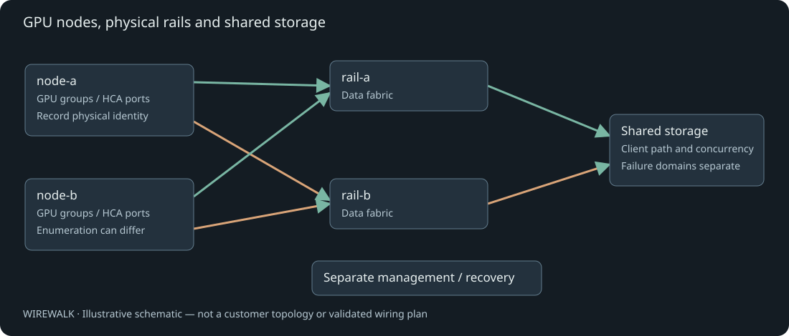

## A rail can be configured and still be the wrong path

This constructed scenario has two GPU servers and two physical fabric rails. Each server exposes two RDMA devices. A job uses both devices, yet communication becomes less predictable when it spans nodes. Inventory alone suggests symmetry; the physical port map tells a different story.

The scenario is deliberately small. Real qualification must include the actual GPU count, PCIe or NVLink topology, HCA ports, switch planes, routing and application placement. A rail is a physical and logical path, not simply a Linux device name.

## Build an identity map before changing NCCL

The example inventory below is fictional. It shows why matching `mlx5_0` on both hosts can be misleading:

| Server | GPU group | Nearest candidate HCA | Physical rail |
|---|---|---|---|
| node-a | group0 | mlx5_0 port1 | rail-a |
| node-a | group1 | mlx5_1 port1 | rail-b |
| node-b | group0 | mlx5_1 port1 | rail-a |
| node-b | group1 | mlx5_0 port1 | rail-b |

Enumeration differs across the two nodes. This table does not prescribe a universal GPU/HCA association; it records an assumed topology for the worked example. Validate PCI identity, firmware inventory and cabling against the actual server diagram.

```bash
nvidia-smi topo -m
lspci -D -t
rdma link show
ibdev2netdev
```

Read the GPU/NIC relationship and CPU affinity in context. A nearby HCA may be a good candidate, but path support, NIC availability, congestion and communication behavior still matter. A topology legend is not a benchmark.

## Check what the ranks actually selected

Use a small allocation with one known workload. Enable bounded NCCL diagnostics for that canary, retain node/rank placement and correlate the selected HCA ports with the physical map. Keep logs per process or node so concurrent writers do not overwrite the evidence. Remove temporary debug overrides after the investigation.

The [NCCL environment reference](https://docs.nvidia.com/deeplearning/nccl/user-guide/docs/env.html) documents HCA filtering and `NCCL_CROSS_NIC`. The latter controls whether rings or trees can use different NICs across nodes, and its appropriate setting depends on the network design. A rail-optimized topology and a fully interconnected fabric need not use the same policy. Do not copy a value without checking the installed NCCL version and the mapping it sees.

## Prove use with deltas

Sample each intended HCA port before and after the same controlled collective. Confirm the exact units and direction. A receive counter on the far endpoint and a transmit counter on the near endpoint should be interpreted over their actual intervals, not summed as independent throughput.

The [offline counter tool](/lab/counter-deltas/) includes synthetic data that produces 1 GiB/s on rail-a and 0.5 GiB/s on rail-b. Those values demonstrate calculation only. An uneven result in a real job needs its own explanation: message placement, topology, saturation, workload phase and measurement timing are all candidates.

## The canary decision

For this scenario, the proposed correction is an explicit, supported mapping based on physical identity, with the job's placement made consistent across nodes. It is tested as a temporary job-scoped experiment before any fleet policy changes.

Compare the original and proposed placement with equal ranks, message sizes, duration, input and node selection. Measure the original application as well as the collective. Verify that every intended rail carries the relevant phase, then exercise a supported path-loss or degraded-path test only within the agreed maintenance scope.

## Leave a map an operator can maintain

The handover should identify GPU groups, HCA BDF/port, physical rail, switch ports, software versions and the configuration owner. Include discovery procedures so a replacement NIC, firmware update or reimage does not silently invalidate a hard-coded index.

No throughput gain or failover behavior is claimed here. A valid result would connect the effective mapping to repeatable application behavior, with any remaining asymmetry explained rather than hidden behind a total.

[See the sample topology](/samples/topology/) · [Follow the distributed-jobs guide](/guides/distributed-jobs/) · [Explore fabric diagnostics](/services/infiniband-roce-diagnostics/).


## Watch the short overview


