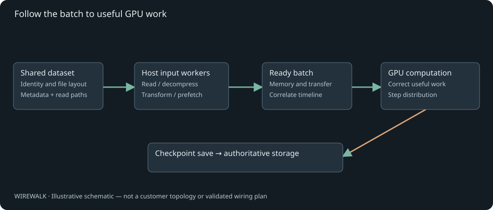

## More storage bandwidth is only one possible answer

In this constructed scenario, training spends noticeable intervals waiting for the next batch. A bulk filesystem benchmark looks respectable, but it does not reproduce the workload: the training input consists of many small objects, CPU transforms and concurrent checkpoint writes.

The investigation follows the batch from discovery to consumption. It records sample enumeration, metadata access, reads, decompression, transformations, host-side queueing, device transfer and the point at which the accelerator can begin useful work. The goal is elapsed research time with correct output and usable recovery, not an isolated storage score.

## Record the workload before tuning a filesystem

Retain dataset identity, file count and size distribution, shard layout, concurrent readers, worker counts, cache conditions, transformation cost and memory pressure. Record where the job runs and which storage clients and network paths it uses.

The [PyTorch DataLoader documentation](https://docs.pytorch.org/docs/stable/data.html) describes worker processes, pinned memory and prefetch-related controls. Their effects depend on the workload and available resources. Increasing workers can create more metadata pressure or CPU contention rather than improving delivery.

Use the [run-record template](/lab/benchmark-records/) to retain these conditions. Do not choose a different dataset for the optimized run and attribute the whole difference to storage.

## Separate the experiment into layers

| Layer | Question | Useful observation |
|---|---|---|
| Dataset discovery | Are many tiny operations delaying the start? | Enumeration/open timing and metadata demand |
| Read delivery | Does concurrency uncover a client, target or fabric limit? | Matched read tests and per-path counter deltas |
| CPU processing | Do decompression and transforms dominate? | Per-worker timing, CPU placement and memory pressure |
| Device supply | Is a batch ready when the GPU needs it? | Application/timeline correlation |
| Checkpoint interference | Do periodic writes change the input path? | Save duration and input timing over the same interval |
| Restart | Can the saved work actually be resumed? | Controlled restore and correctness checks |

This table is an investigation plan, not a report of tests already performed.

## A bounded optimization in the scenario

The candidate change is a prepared, versioned input representation with fewer small-file operations, combined with a measured worker/prefetch configuration. It is a new dataset artifact, not an in-place rewrite of the research source. Record its construction, sample identities, ordering assumptions, preprocessing rules and checksum manifest.

Compare the candidate and original against the same scientific or model-quality requirement. Cache state must be named explicitly; a warmed prepared dataset and a cold original are not equivalent evidence. Include preprocessing and staging time in the total when those costs recur.

Where checkpoint I/O competes with reads, test scheduling or placement changes within the approved storage policy. Do not place the only recoverable checkpoint on unprotected node-local scratch. Retain an authoritative copy and verify the publication and restart path.

## Avoid optimizing away the research question

A smaller stream can be useful only when it preserves the intended work. Validate sample counts, exclusions, schema, ordering where relevant and the agreed training or analysis checks. A faster run that silently drops difficult samples is a different computation.

The existing [research-pipeline investigation](/writing/ninety-seven-percent-of-the-work-was-unnecessary/) illustrates why measuring unnecessary work can matter more than buying hardware. Its genomic format constraints do not automatically transfer to an AI dataset; the lesson is to test semantic equivalence before claiming an optimization.

## What a result should contain

A completed comparison would report time to first useful step, steady-state step distribution, total elapsed time, staging cost, checkpoint/restart behavior and correctness or quality checks. It would include input identity, resource consumption and unresolved limits. No such measured gain is asserted for this fictional scenario.

The next action depends on the evidence. Metadata pressure could justify a layout change. CPU transforms could justify preprocessing or placement work. A shared fabric limit could lead to network diagnostics. Each has a different remedy and a different cost.

[Follow the storage guide](/guides/storage-performance/) · [See the sample remediation plan](/samples/remediation-plan/) · [Explore parallel storage services](/services/parallel-storage/).

## Watch the short overview


